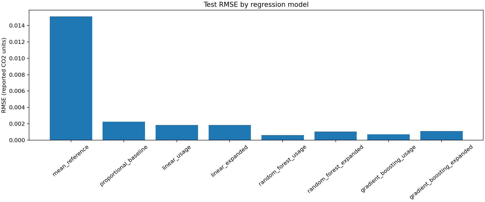

# Predicting electricity-related CO₂ emissions in a steel manufacturing facility

DSC 345 group project using the UCI Steel Industry Energy Consumption dataset.

This repository starts with Bekzat Gulzhigit uulu's baseline and Linear Regression contribution. It includes the original dataset, a reproducible chronological split, evaluated models, saved predictions, and presentation figures. Random Forest, Gradient Boosting, seasonal analysis, and the final combined presentation are not yet included.

## Research questions

- How accurately can electrical measurements estimate the recorded CO₂ target?
- Do additional electrical and operational features improve on electricity usage alone?
- How do Linear Regression and the group's planned tree-based regressors compare?
- Which season has the largest recorded emissions, and what limitations affect interpretation? This question remains for the seasonal analysis.

## Run

Tested with Python 3.12. Create and activate an environment from the repository root:

```bash
python3 -m venv .venv
source .venv/bin/activate
python -m pip install -r requirements.txt
python src/run_baselines.py
```

On Windows, activate with `.venv\Scripts\activate`. No API key or data download is needed. The script also accepts `--data /path/to/Steel_industry_data.csv` and `--output /path/to/output`.

For a walkthrough, open [Bekzat_Baseline_Analysis.ipynb](Bekzat_Baseline_Analysis.ipynb) in a notebook viewer. To execute it, use a Python kernel with the required packages and set the working directory to the repository root. The notebook contains saved outputs; the command-line script does not require Jupyter.

## Initial test results

All models use the same 24,528 training observations and 10,512 test observations. Metrics refer to individual 15-minute observations. MAE and RMSE are in the native target scale; R² is unitless.

| Model | MAE ↓ | RMSE ↓ | R² ↑ |
| --- | ---: | ---: | ---: |
| Training-mean reference | 0.013528 | 0.015138 | -0.019650 |
| Training-calibrated proportional baseline | 0.001993 | 0.002247 | 0.977527 |
| Usage-only Linear Regression | **0.001155** | **0.001837** | **0.984986** |
| Expanded Linear Regression | 0.001251 | 0.001852 | 0.984730 |

Electricity usage alone is a strong benchmark. Additional features slightly worsen this linear model's test errors. This does not establish a winner against the planned tree models. R² is not percentage accuracy.



See [results and methodology](results/README.md) for validation details and limitations, including negative predictions, coarse target values, and uncertain target units.

## Repository contents

| Path | Contents |
| --- | --- |
| `src/run_baselines.py` | Complete baseline, validation, evaluation, and figure-generation code |
| `Bekzat_Baseline_Analysis.ipynb` | Walkthrough with saved results |
| `data/Steel_industry_data.csv` | Unmodified UCI source data |
| `data/README.md` | Data citation, license, and checksum |
| `results/split_manifest.csv` | Exact training/test membership with original source row IDs |
| `results/test_predictions.csv` | Actual values and model predictions on the fixed test rows |
| `results/metrics.csv` | Train/test metrics and negative-prediction counts |
| `results/chronological_validation.csv` | Three validation folds within the training period |
| `results/run_summary.json` | Features, dates, fitted formulas, processing choices, and versions |
| `figures/` | Three reusable PNG figures |
| `requirements.txt` | Pinned analysis dependencies |

## Shared comparison protocol

Use the supplied split for directly comparable model results, subject to the team's agreement. Rows are sorted by the literal day/month/year timestamps; the first 70% train the models and the last 30% evaluate them. Original source row IDs refer to the unmodified included CSV before sorting.

```python
import pandas as pd

raw = pd.read_csv("data/Steel_industry_data.csv")
membership = pd.read_csv("results/split_manifest.csv")
train_ids = membership.loc[membership["split"] == "train", "source_row"].to_numpy()
test_ids = membership.loc[membership["split"] == "test", "source_row"].to_numpy()
train = raw.iloc[train_ids].copy()
test = raw.iloc[test_ids].copy()
```

Fit preprocessing and tune models using training data only. Exclude `CO2(tCO2)` from inputs and preserve `source_row` alongside test predictions for alignment. Save each additional model's outputs separately so the existing baseline results remain identifiable. If the team changes the preprocessing or split, rerun every model on the agreed observations.

## Remaining group work

- Confirm the shared preprocessing and chronological split.
- Add Random Forest and Gradient Boosting implementations and comparable predictions.
- Combine the model results and evaluate feature importance.
- Complete seasonal exploration without treating association as proof of causation.
- Prepare the shared presentation and final written reports.

## Data source

V E, S., Shin, C., & Cho, Y. (2021). *Steel Industry Energy Consumption* [Dataset]. UCI Machine Learning Repository. [doi:10.24432/C52G8C](https://doi.org/10.24432/C52G8C).

The dataset is licensed under [CC BY 4.0](https://creativecommons.org/licenses/by/4.0/). The original CSV is unchanged; preprocessing outputs, predictions, and figures are separate files. This dataset license does not assign a license to the team's code.
